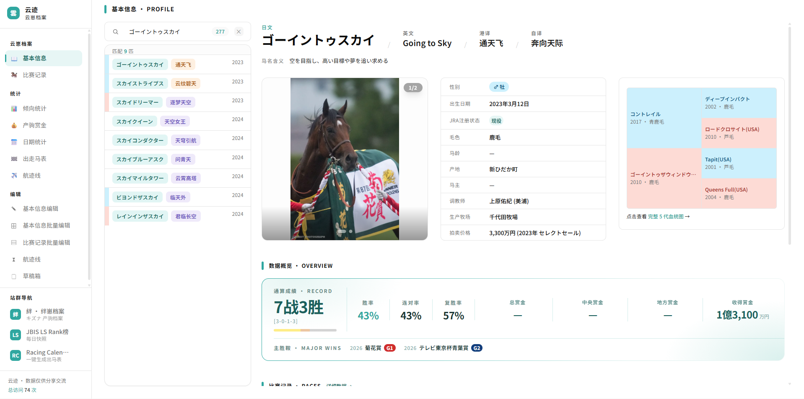
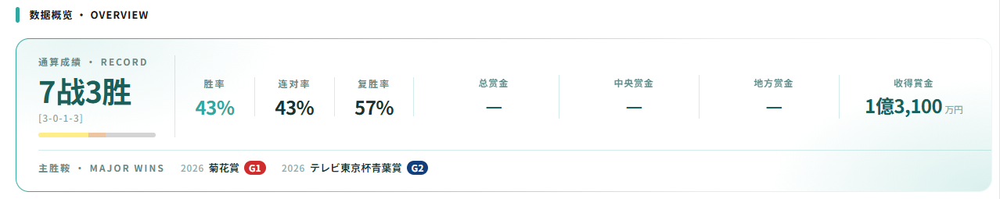
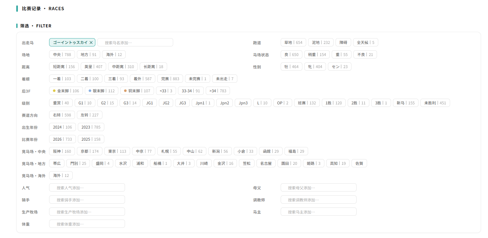
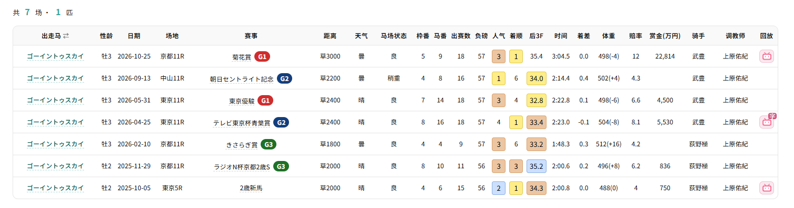
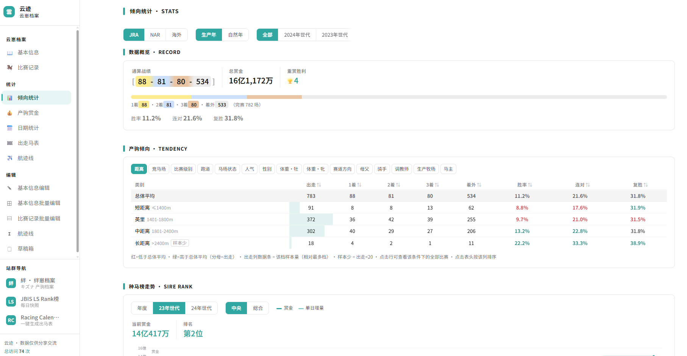
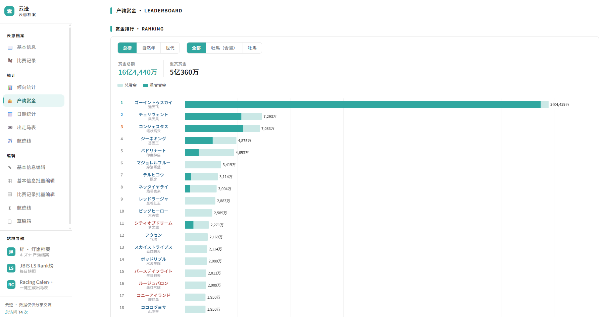
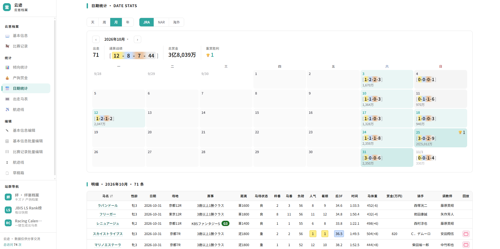
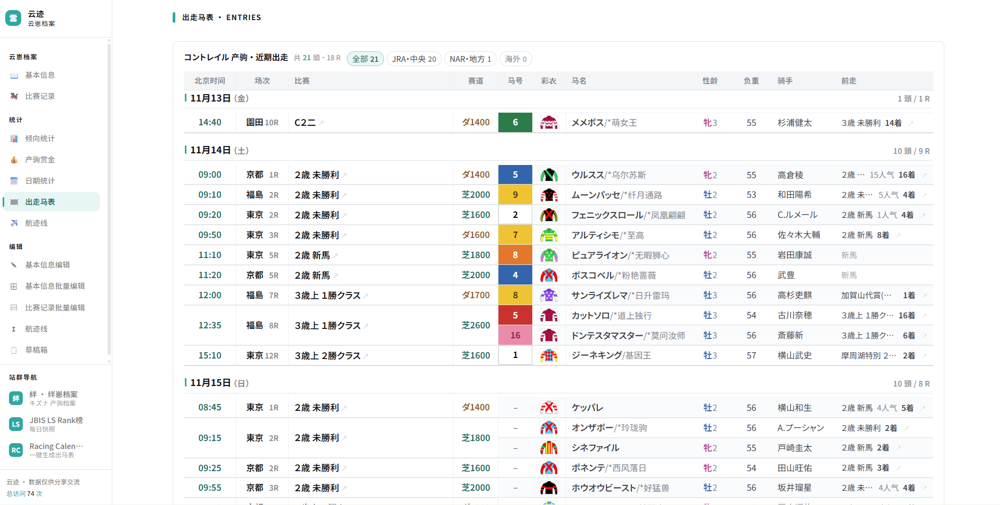
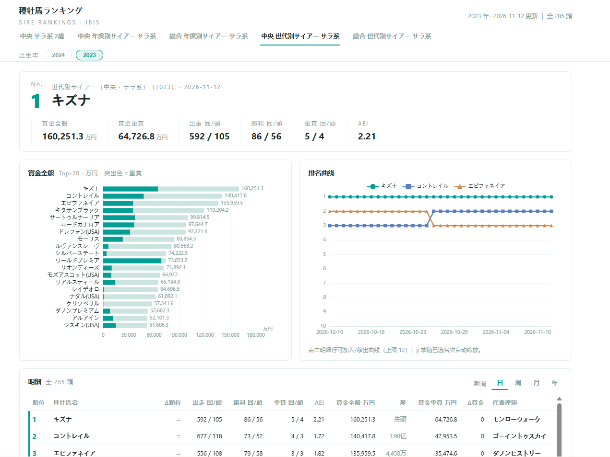
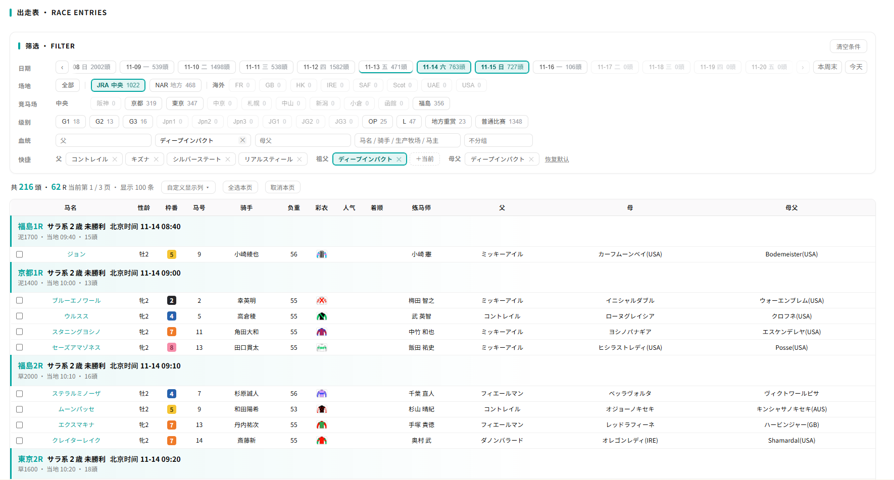

# 云迹 · 云崽档案

> **把阿云所有孩子，做成一座能查、能比、能回看的档案站。**
>
> 收录 **コントレイル（铁鸟翱天 / Contrail）** 的产驹
>
> 在线访问：[www.yunji.xyz](https://www.yunji.xyz/) · 源码：[GitHub](https://github.com/hinotoyk/yunji-web)



---

## 为什么要有这座站

种马产驹的许多信息会散在 JBIS、netkeiba、studbook、赛马报纸和台账里，想看「这一批孩子整体怎么样」，得开会员或者一个个页面点开、手抄、自己算。

云迹把它们收进同一套结构里，回答四类问题：

| 你想知道 | 去哪看 |
|---|---|
| 这匹马是谁、血统怎么来的 | 基本信息（档案页） |
| 它跑过什么、赢了什么、能不能看回放 | 比赛记录 |
| 这一代产驹整体强在哪、弱在哪 | 倾向统计 / 产驹赏金 / 日期统计 |
| 什么时候有云崽出赛 | 出走马表 / 航迹线 |

---

## 九个页面，一条主线

所有页面共享左侧导航，选中一匹马后跨页联动：在档案页点开一匹马，比赛记录、血统、回放会一起跟上，不用重新找。

| 页面 | 它替你做的事 |
|---|---|
| **基本信息** | 单匹马全景：四语名 + 马名含义、相册、基础信息表、2 代血统（可展开 5 代）、数据概览条、内嵌比赛记录；未选马时是全库概览（世代 / 性别 / 状态占比） |
| **比赛记录** | 单马履历（含「回放」列，站内浮层播 B 站源）；也能切到**全库跨马组合查询** |
| **倾向统计** | 把 891 场拆成 15 个切面（场地 / 距离 / 着顺 / 后 3F / 级别 / 赛道方向 / 骑手 / 调教师 / 生产牧场…）+ 种马榜走势 + 年龄成绩曲线 |
| **产驹赏金** | 赏金排行，双系列条形（总赏金 / 重赏赏金），点马名直接跳档案 |
| **日期统计** | 天 / 周 / 月 / 年日历聚合：哪天有几匹出赛、进板、拿重赏，下面是当日明细 |
| **出走马表** | 近期出走一览（由兄弟站 Racing Calendar 渲染，见下文） |
| **航迹线** | 里程碑事件流：级别首胜、重赏、世代新马首胜、父子制霸……带比赛配图 |
| **血统图** | 简约 2 代 + 完整 5 代弹窗（档案页内嵌） |
| **编辑台** | 站主自用：网页上直接改字段 / 批量表格 / 航迹线 / 视频源，PAT 解锁，提交后约 2 分钟全站生效 |

---

## 主要功能

### 1. 一匹马，看得清看得全



四语名不是堆信息，是为了解决真问题：日文名撞名、港译与自译不一致、英文名搜不到。四个槽并排，搜哪个都能命中。血统 2 代直接画在右侧，点开是完整 5 代；数据概览把「7 战 3 胜、胜率 43%、连对率 43%、总赏金 3 亿 4,429 万」压成一条色带，一眼看完。

### 2. 比赛记录 随便你查



**先筛**：场地、距离、着顺、后 3F、级别、赛道方向、出生年份、比赛年份、中央 / 地方 / 海外竞马场、人气、骑手、调教师、生产牧场、马主、体重。每一枚都是带计数的开关，任选组合。



**再看**：一匹马的完整履历。级别徽章（GI / GII / GIII / JG1 / L / OP…）与着顺用统一色标——1 着青绿、2 着青、3 着橙、未完走红；最右一列「回放」在站内浮层里播 B 站源，不跳站。

### 3. 倾向统计：把「感觉这代不错」变成数字



顶部一条通算成绩色带（88 胜 / 81 亚 / 80 季 / 534 着外），下面是对比矩阵：每一行是一个切面，每一列是出走、1 着、2 着、3 着、着外、胜率、连对率、复胜率，并给出「短距离偏弱、英里面稳」这类方向判断。左下角是种马榜走势，直接嵌了兄弟站的数据。

### 4. 赏金排行：一眼看出



总赏金与重赏赏金分两层画同一根条：浅色是总额，深色是重赏部分，越靠上越能看出「靠一场大赏撑起来的」还是「稳定进板攒出来的」。合计 16 亿 4,440 万日元，重赏部分 5 亿 360 万。

### 5. 日期统计：赛程的另一种读法



切成天 / 周 / 月 / 年，每一格显示当天几匹出赛、战绩如何、进账多少赏金，重赏日用标识挑出来。想验证「这批马在哪个阶段集中出成绩」，看颜色深浅比翻列表快。

### 6. 航迹线：所有里程碑都值得被记住


不按时间排流水账，只记里程碑：世代首胜、级别首胜、重赏、父子制霸。每个节点带比赛照片和当场数据（时间、后 3F、人气、骑手、负重），上下滚动时年份胶囊一直贴在顶部当锚点。

### 7. 出走马表：任何时间任何地点都能看



按北京时间分组列出近期出走：几天几场、哪匹、什么级别、哪个竞马场、几号闸、谁骑。这一整块由兄弟站 Racing Calendar 的渲染组件提供。

---

## 兄弟站

云迹不是孤岛：几座同源站点各管一件事，需要的时候互相搭桥。



**[JBIS LS Rank 榜](https://hinotoyk.github.io/jbis-sire-rank-history/?type=t2-annual-central&year=2026)** —— 种马排行榜的每日快照。云迹「倾向统计」页底部的种马榜走势就来自这里，能直接看到这匹种马今年在榜上第几、和前面几匹差多少。



**[Racing Calendar](https://hinotoyk.github.io/racing-calendar/?d=2026-11-13&w=2026-10-22&scope=NAR)** —— 出马表生成器。云迹「出走马表」整页由它渲染，点「本周 / 今天」切换范围、按场地与级别筛，都是它的能力。

| 站点 | 是什么 | 与云迹的关系 |
|---|---|---|
| [云迹 · 云崽档案](https://www.yunji.xyz/) | コントレイル 产驹档案（本站） | 主站 |
| [絆 · 绊崽档案](https://hinotoyk.github.io/kzn-web/dist/) | キズナ 产驹档案 | **同类产品**：同一套模板搭的另一座站，结构一致、数据各自独立 |
| [JBIS LS Rank 榜](https://hinotoyk.github.io/jbis-sire-rank-history/) | 种马排行每日快照 | 云迹嵌入其走势图 |
| [Racing Calendar](https://hinotoyk.github.io/racing-calendar/) | 出马表生成器 | 云迹嵌入其出走马表 |

跨站都是**可选**的：没配兄弟站，对应板块整块不出现，不会留半截或 404。

---

## 数据从哪来，多久更新一次

- **来源**：JBIS（产驹登记）、netkeiba（比赛成绩与马匹详情）、studbook.jp（血统）、赛事台账（海外场）。全部是公开资料的整理，不做二次售卖。
- **更新**：每天 **06:00** 全量对账建档（新马入库、成绩补缺、判变更新），每天 **21:00** 当日赛果快更；登録状态与 B 站回放匹配各跑一条独立支线。有变化才提交，没变化就不打扰。
- **人工修正**：机器抓不准的字段（译名、照片、视频源、里程碑措辞）走编辑台，改的是独立的人工表，下一轮自动更新不会覆盖。
- **兜底**：数据一致性校验 + 六条离线断言脚本（见文末「改完必跑」），红了就不发版。

---

## 配置即站点身份：换一匹应援的马，不改代码

这套东西不只为一座站写。想给别的种马建同样的档案站，**不用动源码**——站名、种马、域名、编辑仓库、统计账号、友链、跨站地址全在 `config/` 的五个 JSON 里：

| 文件 | 管什么 |
|---|---|
| `config/sire.json` | 种马档案（JBIS / netkeiba ID、多语名、studbook、生年）+ 站点身份（站名四件套、域名、编辑仓库、统计、跨站地址） |
| `config/features.json` | 页面能力表：哪几个功能页挂载，写 `false` 即关（入口消失、直连显示「本站未启用」，不 404） |
| `config/friend-links.json` | 侧栏「站群导航」友链数组 |
| `config/video-sources.json` | B 站 UP 主 mid 与匹配规则（留空 = 回放功能关闭） |
| `config/grade-table.json` | 级别（GI / GII / …）归一表 |

空值是**合法的关闭态**，不是错误：`repo` 空 = 编辑台关闭、`analytics` 空 = 不做统计、`cross_site` 空 = 该跨站板块整体消失。

完整分步手册（必填字段、品牌文件清单、首次抓数据、常见坑）：**[docs/FORK.md](docs/FORK.md)**。手册写给 AI 执行，clone 之后跟着一条条做即可。

---

## 维护与排障

日常三条自动线，人工只在失败时介入：`update-data`（每日 06:00 全量对账）→ 串联 `status`（登録状态）与 `video-task`（B 站回放匹配）；`update-day`（每日 21:00 当天赛果快更）。

**更新数据**（统一入口，未配 `--year` 时按配置里的生年处理）：

| 命令 | 做什么 |
|---|---|
| `python run_update.py --ci` | 基本 + 比赛 + 校验 + 派生 + 提交（CI 每日用这条） |
| `python run_update.py --basic` | 新马对账建档 + 补缺 + 合并 |
| `python run_update.py --races [--since N]` | 详情判变 + 成绩增量 + 台账海外 + 合并 |
| `python run_update.py --day 20261020` | 按天快更赛果（幂等，与全量互不覆盖） |
| `python run_update.py --check [--fix]` | 一致性校验（附「数据体检」报告，不阻断流程） |

⚠ `--init` / `--races-force` 会删空或覆盖 `data/`，先备份。人工值只写 `data/manual_overrides.json`：`data/basic.json` 是合并产物，手改会被下一轮 merge 覆盖。

**本地预览**：`cd front && npm run build` → `python serve.py`（端口 9090，必须 http 访问；`file://` 下取不到数据）。

**改完必跑（离线，不联网）**，六条全绿才算没破契约：

```bash
node scripts/races/verify_drill.cjs        # 比赛记录下钻
node scripts/races/verify_result.cjs       # 着顺三态口径
node scripts/stats/verify_stats.cjs        # 统计总览
node scripts/datechart/verify_datechart.cjs
node scripts/timeline/verify_sire_wins.cjs
node scripts/verify_caps.cjs               # 页面能力表（改过 features.json 必跑）
```

**疑难速查**：

| 症状 | 先查 |
|---|---|
| 改了样式没生效 | 没 build；或动态拼接的 Tailwind 类被裁剪（去 `dist/assets/theme-*.css` 搜类名） |
| 线上侧栏高亮全灭 | Cloudflare 把 `/pages/x.html` 剥成 `/pages/x`，路径比对要先经外壳 `pageKey()` 归一 |
| 编辑台打不开 / 403 | `site.repo` 与 PAT 所属仓库不一致（双站防串是故意的） |
| 某匹马数据一直缺 | `python run_update.py --horse <id>` 定向跑；再看 `data/fetch_log.jsonl` 里该 host 的状态码 |
| 全量跑到一半被掐断 | 连续 20 分钟无输出判卡死，属有意设计：不完整缓存不许合并提交 |
| 访客数不涨 | `site.domains` 是否含当前域名；统计后台是否开了计数端点 |

改代码前请先读 [AGENTS.md](AGENTS.md)（硬规则）与 [docs/DESIGN.md](docs/DESIGN.md)（架构与编码约定）；数据字段口径见 [docs/SCHEMA.md](docs/SCHEMA.md)。

---

## 文档导航

| 文档 | 内容 |
|---|---|
| [docs/FORK.md](docs/FORK.md) | 克隆后改成自己应援站的分步手册（给 AI 执行） |
| [docs/DESIGN.md](docs/DESIGN.md) | 架构与约定的唯一出处：前端架构 / 编码约定 / 数据管线 / 编辑台 / 决策时间线 |
| [AGENTS.md](AGENTS.md) | 硬规则清单（禁止事项与判据） |
| [docs/SCHEMA.md](docs/SCHEMA.md) | 数据产物字段契约（改字段先改这里） |
| [docs/request-path.html](docs/request-path.html) | 请求·数据流路径图（浏览器打开） |

---

## 授权与边界

- **代码**：[MIT](LICENSE) © 2026 hinotoyk。
- **数据与图片**：版权归 JBIS / netkeiba / studbook.jp 及各摄影者所有，**不在** MIT 授权范围内，使用边界见 [NOTICE](NOTICE)。
- **商标**：「云迹 / 云崽档案 / 雲」标识不随代码授权，fork 后请更换品牌，避免与原站混淆。
- 本站为个人非商业性质的资料整理与查阅站。
