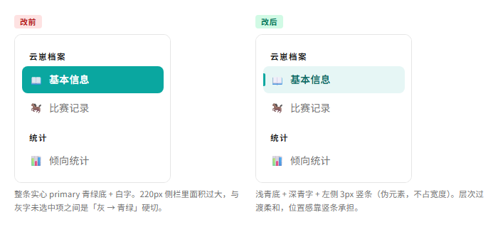
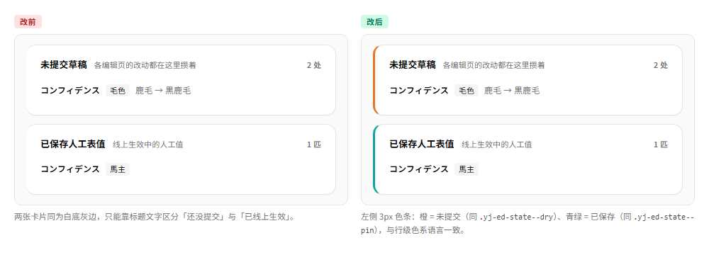
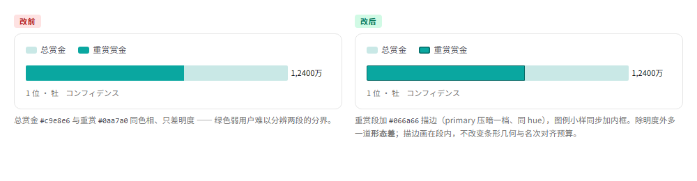
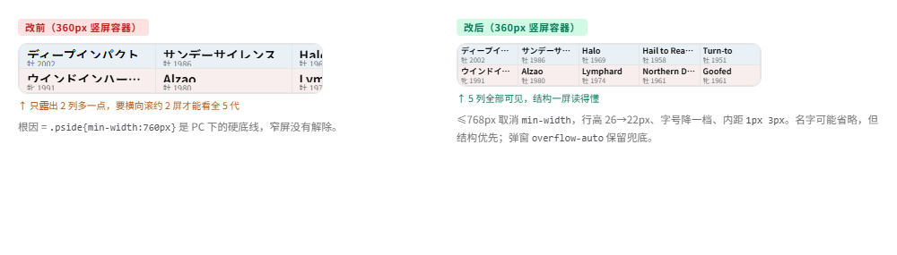

# 云迹 · UI 设计审查报告（2026-10-30）

> 本文档是一次**全站 UI 审查 + 整改落地**的记录：先逐页审读现有实现，提出 31 项修改建议，
> 再按优先级实施，最后逐项复核。
> 与 `docs/UI优化记录.md` 的分工是——那边记「每个模块的最终方案」，这里记
> 「本次审查发现了什么、改了什么、哪些建议被否掉以及为什么」。
>
> 审查基线：`front/` 全部 11 个页面 + 2 个公共 JS + `tailwind.config.js` + `theme.css`。
> 整改结果：**14 个文件修改、1 个文件新增，+247 / −150 行**；`npm run build` 通过。

---

## 一、审查方法

### 1.1 分层审读

设计系统按四层拆开看，问题分别归属到对应层：

| 层 | 出处 | 审查重点 |
|---|---|---|
| Token 层 | `tailwind.config.js` | 色/字/圆角/间距是否完备、有无重复或死键 |
| 组件层 | `theme.css` `@layer components` | 组件是否单一出处、有无跨页重复定义 |
| 页面层 | 各页 `<style>` | 页内样式是否只装「本页专属」、有无跨页副本 |
| 业务语义层 | `race-rows.js` / `yj-util.js` | 徽章、色值、名称处理是否单一出处 |

### 1.2 逐页对照

11 个页面全部实读源码（不是凭印象），重点看：信息层级、留白节奏、色彩语义、
响应式退化、状态可见性（草稿/模式/加载）、可维护性（文件体积、重复定义）。

### 1.3 结论先行

**整体完成度 8/10。** 设计系统意识很强：三层架构清晰、单一出处原则贯彻到位、
业务语义色有 JS/CSS 双处互指注释、`@layer` 裁剪规则理解准确。
短板不在「设计判断」，而在**工程化债务**：跨页重复定义、页内样式体积、响应式细节、状态可见性。

---

## 二、逐项对照图解（含截图）

> **关于截图**：对照图由 `tests/ui-review-2026-10-30/*.html` 渲染，
> 视觉原子直接引用 `dist/assets/theme-*.css` 真实编译产物（「改后」栏 = 线上真实渲染），
> 「改前」栏用显式覆盖还原旧规格。截图命令见 §5.2。
> 三处**视觉零变化**的改动（KPI 条收口、时间线卡片去重、空态统一）不放截图，只在 §2.8 做文字说明。

### 2.1 外壳侧栏 · 导航选中态

| 项 | 内容 |
|---|---|
| **页面** | 全站外壳 `front/index.html` · 左侧导航（含 `?edit=1` 时的「编辑」分组） |
| **位置** | 每个 `.nav-item` 的选中态 |
| **改前** | 整条实心 primary 青绿底（`#0aa7a0`）+ 白字。220px 侧栏里面积过大，与灰字未选中项之间是「灰 → 青绿」硬切，缺层次过渡 |
| **改后** | 浅青底（`bg-accent` `#e6f6f5`）+ 深青字（`accent-foreground` `#0b6b64`）+ 左侧 3px 竖条。竖条是伪元素，`scaleY` 进出，**不占布局宽度**，文字起始位置不变 |



---

### 2.2 比赛记录页 · 跨马查询模式提示

| 项 | 内容 |
|---|---|
| **页面** | `front/pages/races.html` |
| **位置** | `page-title` 之下、`#selector` 之上（新增 `#modeHint`） |
| **改前** | 页头之后直接是维度条。本页有两种形态——独立模式（全库跨马查询）与 embed 模式（profile 内嵌单马记录），此前只能靠「有没有筛选条」猜自己在哪种模式 |
| **改后** | 新增一条浅青底 + primary 描边的说明条：「**全库跨马查询** · 下方维度条可自由组合：同维多选 = 或，跨维 = 且」。embed 模式按 id 隐藏；`max-md:hidden`（移动端筛选条本就纵向堆叠，不再多占一行） |


---

### 2.3 编辑台基本信息 · 页级草稿提示

| 项 | 内容 |
|---|---|
| **页面** | `front/pages/edit.html` |
| **位置** | `<header>` 之下、工作表卡之上（新增 `#draftBanner`） |
| **改前** | 「有未提交改动」只在**底部固定保存条**里体现（橙色小圆点 + 变更摘要）。用户改字段时视线在页面上方，很容易忘掉底部还压着东西就关页 |
| **改后** | 页首出现橙色提示条：「本匹有 **N** 处未提交改动 · 已在草稿箱攒着，点底部「提交到 GitHub」才线上生效」。**有改动才出现**，无改动整条 `display:none` 不占位 |
| **实现取舍** | 计数由保存条 `#summary` 里 `.yj-ed-diff` 的行数**单向镜像**（`MutationObserver`），**没有改 `editor.js`** —— 该文件与 kzn 仓逐字节对齐，改它就要双仓同步 |


---

### 2.4 草稿箱查询页 · 两块卡片的状态区分

| 项 | 内容 |
|---|---|
| **页面** | `front/pages/edit-drafts.html`（渲染在 `public/editor.js` 的 `draftsHTML()`） |
| **位置** | 「未提交草稿」卡与「已保存人工表值」卡的左边框 |
| **改前** | 两张卡片同为白底 + 灰边，只能靠标题文字区分「还没提交」与「已线上生效」 |
| **改后** | 各加 3px 左色条：未提交 = 橙（`chart3`，同 `.yj-ed-state--dry`）、已保存 = 青绿（`primary`，同 `.yj-ed-state--pin`）—— 与行级色系语言对齐 |



---

### 2.5 产驹赏金 · 双系列条形图的色觉可分性

| 项 | 内容 |
|---|---|
| **页面** | `front/pages/leaderboard.html` |
| **位置** | ECharts「重赏赏金」系列 `itemStyle` + 图例小样 |
| **改前** | 总赏金 `#c9e8e6`（浅青）与重赏 `#0aa7a0`（主色）**同色相、只差明度**。绿色弱用户难以分辨两段分界 |
| **改后** | 重赏段加 `#066a66` 描边（primary 压暗一档、同 hue），图例小样同步加 `inset 0 0 0 1.5px #066a66`。除明度外多一道**形态差**；描边画在段内，**不改变条形几何与名次对齐预算** |



---

### 2.6 批量表格 · 快捷键说明

| 项 | 内容 |
|---|---|
| **页面** | `front/pages/edit-table.html` |
| **位置** | `<header>` 第一行的快捷键说明 |
| **改前** | 一整行纯文本：「点单元格就地改 · Enter 下移 / Tab 右移 / 方向键移动 · Ctrl+Z 撤销 / Ctrl+Y 重做 · Delete 清格」。键名淹没在句子里，扫读要逐字找 |
| **改后** | 键名改 `<kbd>` 胶囊（等宽字体 + 1px 下边框模拟键帽，10px 字号避免撑高 header 行），动词保留在胶囊外 |


---

### 2.7 血统图 · 5 代弹窗的窄屏适配

| 项 | 内容 |
|---|---|
| **页面** | `front/pages/pedigree.html`（弹窗渲染在 `public/pedigree.js`） |
| **位置** | 完整 5 代血统网格 `.pside` |
| **改前** | `.pside{min-width:760px}` 是 PC 下「5 代名字不被挤成省略号」的硬底线，窄屏没有解除。375px 竖屏下只露出 2 列多一点，要横向滚约 2 屏才能看全 |
| **改后** | `@media (max-width:768px)` 内取消 `min-width`，行高 26→22px、字号降一档（9px / meta 7.5px）、单元格内距 `1px 3px`。**结构一屏可读**；名字可能省略，弹窗 body 的 `overflow-auto` 保留兜底 |



---

### 2.8 视觉零变化的三处（纯代码收口）

这三项**不产生像素差异**，因此不放截图，改动价值在于「以后不会再分叉」：

| 项 | 页面 | 改前 | 改后 |
|---|---|---|---|
| **KPI 条收口** | `stats` / `datechart` / `leaderboard` 三页 | `.st-kpi` / `.dc-kpi` / `.lb-kpi` **三份逐字节相同**的六行定义（padding `2px 18px`、分隔线 `#ececec`、k `11px`、v `20px`、hi `#0aa7a0`、mb 媒体查询） | 统一为 `theme.css` 的 `.yj-kpis` / `.yj-kpi`，三页只留各自特有图标（`.trophy`） |
| **时间线卡片去重** | `timeline` / `edit-timeline` | `edit-timeline.html` 的 `.yj-pv` 块是 `timeline.html` 页内 `<style>` 的**人工复制副本**（原注释明写「样式复制自 timeline.html」） | 抽 `pages/timeline-cards.css` 装「视觉原子」，两页共同引用；**布局骨架不共享**（正式页居中轴线左右交替 vs 预览单侧一行，grid 不通用） |
| **空态统一** | `theme.css` + `stats` / `leaderboard` | `.hint-empty` 60px 大留白版（theme.css）与 26px 紧凑版（stats/leaderboard 各自覆盖）并存，同站两种空态间距；其中 stats 那份**页内零使用**（死 CSS） | 新增 `.hint-empty--sm` 紧凑变体；leaderboard 三处改用变体、stats 死覆盖删除 |

---

### 2.9 其余小改动一览

| 页面 | 位置 | 改前 | 改后 |
|---|---|---|---|
| 外壳 `index.html` | 内容 iframe | 换 `src` 时旧文档卸载与新文档首绘之间有一帧空白 | 挂 `.loading` 降不透明度，`load` 后摘掉（160ms 淡入，reduced-motion 关动画） |
| `profile.html` | 两栏栅格 | 搜索列固定 350px，768–1024px 下吃掉近 1/3 宽度 | `280px` → `lg` 起 `350px`；mb 端搜索列限高 45vh 可滚 |
| `profile.html` | 概览 treemap 色块 | 原生 `title` 只有「类别 · N 匹」 | 补占比：「类别 · N 匹 · X.X%」（块 `overflow:hidden`，伪元素浮层会被裁，所以用原生 title） |
| `timeline.html` | `fitRaceNames()` 下限 | `NAME_FLOOR = 10.5`，日文假名辨识吃力 | 提到 11 |
| `timeline.html` / `races.html` | 页面容器内距 | `pt-[22px]`，其余页面 `pt-[26px]` | 统一 `pt-[26px]` |
| `datechart.html` | 口径/单位切换 | 整块 `innerHTML` 替换，无任何过渡 | `.dc-fade` 150ms 淡入（摘类 → 强制 reflow → 挂类，连点也能重播） |
| `leaderboard.html` | 移动端分页 | 10 条/页，200 匹要翻 20 页 | 20 条/页（约 2~3 屏） |
| `tailwind.config.js` | token | 无 `spacing` 语义令牌；无 `darkMode`；`chart4` 与 `chart2` 同值且全站零引用 | 加 `section/card/row/tight` 四档间距、`darkMode:'class'`（仅留开关）、`chart4` 改 `#5b9bd5` |

---

## 三、已落地的修改（详细说明）

### 3.1 Token 层

#### §1 `tailwind.config.js` — 补语义间距令牌

- **原状**：`extend` 只有 `colors` / `fontFamily` / `borderRadius`，间距全靠默认 scale + 各页硬编码 px。
- **改法**：新增 `spacing` 四档语义令牌（只增不改，不覆盖默认 scale）：
  `section: 48px` / `card: 24px` / `row: 12px` / `tight: 8px`。
- **说明**：令牌先建立、暂不强制替换既有硬编码 —— 全量替换涉及十余个页面，风险与收益不匹配，
  留给后续按模块逐步迁移。

#### §2 `tailwind.config.js` — 预留暗色模式扩展点

- **原状**：无 `darkMode` 字段，深色 token 完全没有。
- **改法**：挂 `darkMode: 'class'`（当前不实现、不写任何 `dark:` 类），
  并在 `theme.css` 的 `@layer components` 开头列出一份「将来接暗色时必须补的写死 hex 清单」。
- **价值**：将来接入只需给 `<html>` 加 `.dark` 并逐组件补变体，不必再改构建配置。

#### §3 `tailwind.config.js` — `chart4` 与 `chart2` 同值

- **原状**：`chart2: '#0f8fd6'`、`chart4: '#0f8fd6'` 完全同值。
- **核实**：全站 grep 确认 `chart4` **零引用**（无任何 `bg-/text-/border-chart4`）。
- **改法**：保留键位，值改为可辨识的浅蓝 `#5b9bd5`，并注明「若后人误当别名并列使用会导致两系列不可分」。
- **风险**：零（无引用）。

### 3.2 组件层（`theme.css`）

#### §29 KPI 条三页重复 → 收口为 `.yj-kpis` / `.yj-kpi`【本次收益最高】

- **原状**：`stats.html` 的 `.st-kpi`、`datechart.html` 的 `.dc-kpi`、`leaderboard.html` 的 `.lb-kpi`
  各自定义 6 条规则，逐项对比**完全一致**（见 §2.8 表）。属 §48 第 5 条「≥3 处使用」的收口门槛内，
  但历史上一直是三份副本。
- **改法**：在 `theme.css` `@layer components` 新增 `.yj-kpis` / `.yj-kpi`（含媒体查询），
  三页删除本地定义，类名改为 `.yj-kpi`；各页特有的图标样式（`.st-trophy` / `.dc-kpi .trophy`）保留，
  奖杯选择器改为挂在 `.yj-kpi` 之下。
- **验证**：`dist` 中 `.yj-kpi` 6 条规则 + 2 条媒体查询规则齐备；
  源码与产物中 `.st-kpi` / `.dc-kpi` / `.lb-kpi` **零残留**（仅注释里作为历史记录出现）。

#### §30 `.hint-empty` 定义分叉 → 统一 + 紧凑变体

- **原状**：`theme.css` 是 60px 大留白版（13.5px 字），`stats.html` 与 `leaderboard.html`
  各自覆盖成 26px 紧凑版（13px 字、`#a1a1aa`）。同站两种空态间距。
- **核实**：`stats.html` 里那份覆盖**页内零使用**（纯死 CSS）。
- **改法**：新增 `.hint-empty--sm`（26px 紧凑版）到 `theme.css`；`leaderboard.html` 三处空态改用
  `hint-empty hint-empty--sm` 并删除本地定义；`stats.html` 的死覆盖直接删除。
- **验证**：产物中 `.hint-empty` 在 `.hint-empty--sm` 之前（同权重后者胜出），层叠顺序正确。

#### §4 侧栏选中态降重 + 竖条指示器

- 详见 §2.1。竖条由 `.nav-item::before` 承担（`scaleY` 进出，`prefers-reduced-motion` 关动画）。
- **落地**：`index.html`（10 个 nav-item，含 `#editNav` 模板）、`theme.css`
- **验证**：`dist` 产物含 `.nav-item:before` 与 `.nav-item[data-on=true]:before`；
  `index.html` 中仅剩的 `bg-primary` 是站点 logo 方块（应保留）。

### 3.3 外壳 `index.html`

#### §5 切页白屏 → 160ms 淡入

- **改法**：`#frame` 加 `opacity` 过渡；`go()` 里先挂 `.loading`（opacity:0），
  `load` 回调里摘掉。样式写在外壳自己的 `<style>`（只有外壳用得到，不进 theme.css）。
- **降级**：`prefers-reduced-motion: reduce` 下取消过渡并保持 opacity:1。
- **验证**：`dist/index.html` 内联样式含 `frame.loading { opacity: 0 }` 与降级分支。

### 3.4 `profile.html`

#### §9 搜索列宽响应式分档 + 移动端限高

- **改法**：
  - 列宽 `grid-cols-[280px_minmax(0,1fr)] lg:grid-cols-[350px_minmax(0,1fr)]`
    —— md 档收窄到 280px，≥1024px 才回到 350px；
  - 搜索列容器加 `max-md:max-h-[45vh] max-md:overflow-y-auto`。

#### §8 treemap 悬停说明补占比

- **核实**：色块**本来就有** `title`（原生悬停），此前审查初判「无 tooltip」有误。
- **改法**：保留原生 `title`（块本身 `overflow:hidden`，伪元素浮层会被裁掉，所以不能用 CSS tooltip），
  文案补上占比：`类别含义 · N 匹 · X.X%`（占比仅在传入 `pctSum` 的概览图出现）。
- **落地**：`profile.html` `tmHTML()`

### 3.5 `races.html`

#### §12 跨马查询模式提示条

- 详见 §2.2。

#### §31 页面容器内距统一

- `timeline.html` / `races.html` 的 `pt-[22px]` → `pt-[26px]`。

### 3.6 `timeline.html`

#### §26 卡片样式双重维护 → 抽 `timeline-cards.css`

- **改法**：新建 `front/pages/timeline-cards.css`，装「两处完全一致的视觉原子」：
  卡片壳 `.tl-card`、图位 `.tl-photo`、文本区 `.tl-body`、赛事名行 `.tl-racename*`、
  事件标签 `.tl-tag*` + 皇冠、迷你数据条 `.tl-kpis/.tl-kpi`、节点圆点 `.tl-node` 底座、
  日期排版 `.tl-date`、以及卡片内徽章变体（`.tl .yj-grade` / `.yj-pv .yj-grade` 双作用域）。
  两页改为 `<link rel="stylesheet" href="timeline-cards.css">`。
- **不共享的部分**（留在各自页内）：**布局骨架** —— 正式页是「居中轴线 + 左右交替」，
  预览是「单侧一行」（`date | node | card`），`grid-template` 根本不同，强行合并只会互相牵制。
- **验证**：产物 `timeline-cards-*.css`（2.29 kB / gzip 0.91 kB）由两页共同引用，
  `<link>` 顺序为 theme.css → timeline-cards.css；徽章覆盖走「未分层 > `@layer components`」的
  层优先级，与链接先后无关，机制可靠。

#### §15 赛事名字号下限 10.5 → 11

- 日文假名在 10.5px 下辨识吃力，11 是可读性与适配率的折中点。

#### §16 徽章变体补「为什么」

- **原状**：`.yj-grade{margin-left:0}` 看起来像在修 bug，容易被后人「顺手修正」回去。
- **改法**：扩写注释，说明这是**有意变体**：theme.css 的 `margin-left:6px` 是给「表格里紧跟文字」
  留的空隙，而卡片里徽章是行首元素；`.yj-no` 26px→22px 是因为卡片行比表格行矮。
  同时写明机制（未分层 > 分层）、禁止改成 `!important`、禁止删 theme.css 原值。
  （该注释随 §26 迁移到 `timeline-cards.css` 文件头。）

### 3.7 `datechart.html`

#### §20 口径/单位切换补入场反馈

- **改法**：新增 `.dc-fade` 动画（150ms opacity 0.35→1）+ `fadeIn()`，`render()` 末尾调用。
  重播用标准写法（摘类 → 强制 reflow → 挂类），连续切换也能重播。`prefers-reduced-motion` 关动画。
- **注意**：`render()` 只在口径/场地/锚点变化时调用，明细分页走 `renderDetail()`，因此翻页不会误闪。

### 3.8 `leaderboard.html`

#### §21 双系列补形态差（不止靠颜色深浅）

- 详见 §2.5。

#### §22 移动端分页 10 → 20 条/页

- **原状**：200 匹要翻 20 页，横向对比被切碎。改 20 条（约 2~3 屏），翻页次数减半。

### 3.9 `pedigree.js`

#### §23 5 代血统图小屏溢出

- 详见 §2.7。

### 3.10 编辑台

#### §24 `edit.html` — 页级草稿提示

- 详见 §2.3。

#### §26 `edit-timeline.html` — 预览样式去重

- 详见 §2.8 与 §3.6。

#### §27 `edit-table.html` — 快捷键用 `<kbd>` 胶囊

- 详见 §2.6。

#### §28 `editor.js` — 草稿箱两卡加左侧色条

- 详见 §2.4。
- **⚠ 双仓同步**：`editor.js` 与 kzn 仓逐字节对齐，本次改动需同步到 kzn（kzn 侧记 §117）。

---

## 四、被撤回 / 降级的建议（9 项）

审查报告里提出的建议并非全部成立。以下 9 项在实施阶段复核后**主动撤回或降级**，
原因记录在此，避免后人重复踩坑。

| 原编号 | 原建议 | 复核结论 | 处置 |
|---|---|---|---|
| §6 | 手机菜单钮改 `fixed` 悬浮，省掉 28px 顶栏 | **不成立**：各页 mb 端顶部内距只有 `pt-2`（8px），悬浮钮占 4~30px 高、8~34px 宽，会直接压住 `page-title` 首字；要避让得把内距加到 `pt-9`，净高度与原 28px 窄条**完全相等** → 收益为零，还多一层遮挡风险 | **已回退**，恢复窄条并在 `index.html` 写明原因 |
| §7 | 名字四槽 `items-end` → `items-baseline` | **改不动**：每个名字槽是 `flex-col`（标签在上、名字在下），父容器 `items-baseline` 会对齐到**标签**的基线而不是名字，反而更错。`items-end` 才是 flex-col 场景的正解 | 保持原状 |
| §10 | 相册加 `1/N` 分页指示器 | **已存在**：`pav-count` 早就实现了「半透明白底 + 毛玻璃 + 阴影 + `1/N`」，审查初判遗漏 | 无需改动 |
| §13 | 宽屏密度分档（fs125~fs155） | **已存在**：`races.html` 已有四档按表内留白自动切换，实现相当成熟 | 无需改动 |
| §14 | 移动端年份胶囊左缩进 28px → 23px | **原值是对的**：卡片起点 16px + 卡片边框 1px + 卡内 `padding` 12px ≈ 29px，28px 正好对齐卡片内文字左缘 | 保持原状 |
| §17 | KPI 条加「同马群均值」对比基准 | **需数据侧配合**：均值基准目前只在矩阵表里以「基准行」形式存在，KPI 带的指标口径与之不完全同构，硬接会给出误导性的比较 | 降级为遗留项 |
| §18 | 分节条 0 值出现视觉空洞 | **不成立**：`.st-brk b` 有 `padding:1px 6px` + 底色，值为 0 时色块照常铺满，不会空洞 | 无需改动 |
| §25 | 底部保存条无改动时收起为悬浮钮 | **风险 > 收益**：保存条是「提交到 GitHub」的唯一入口，收起后容易让用户找不到提交动作；且需改 `editor.js`（双仓同步） | 降级为遗留项 |
| §31 | `pedigree.html` 补 `md:w-[90%]` | **不该加**：该页内容定宽 880px，`max-w` 已封顶；加 90% 只会让 ~900px 视口下反而变窄。窄内容是血统图的固有属性，与内容页满铺是两种合理形态 | 仅统一 `pt`，不加宽度 |

---

## 五、验证记录

### 5.1 构建

```
cd front && COPY_DATA=skip npm run build
→ ✓ built in 8.70s
```

产物规模（节选）：

| 文件 | 原始 | gzip |
|---|---|---|
| `theme-*.css` | 63.36 kB | 11.47 kB |
| `timeline-cards-*.css`（新增） | 2.29 kB | 0.91 kB |
| `pages/timeline.html` | 13.64 kB | 6.99 kB |
| `pages/leaderboard.html` | 24.01 kB | 12.12 kB |
| `pages/edit-timeline.html` | 4.10 kB | 2.65 kB |

### 5.2 截图与产物核对

**截图**：`tests/ui-review-2026-10-30/` 下 7 个对照页 + `shell.css`，用 Edge 无头模式渲染：

```bash
msedge --headless=new --disable-gpu --hide-scrollbars \
       --virtual-time-budget=3000 --window-size=1000,330 \
       --screenshot="<输出>.png" "file:///<对照页>.html"
```

> 提示：`--virtual-time-budget` 必须给，否则 Edge 会在页面绘制前就截屏（得到空白图）。

| 检查项 | 结果 |
|---|---|
| `.yj-kpis` / `.yj-kpi` 6 条规则 + 2 条媒体查询 | ✅ 齐备 |
| `.hint-empty--sm` 定义在 `.hint-empty` 之后（层叠正确） | ✅ |
| `.nav-item:before` / `.nav-item[data-on=true]:before` | ✅ 已输出 |
| `.st-kpi` / `.dc-kpi` / `.lb-kpi` 残留 | ✅ 零（仅注释中的历史记录） |
| `timeline-cards.css` 两页共同引用，顺序 theme → cards | ✅ |
| `.tl .yj-grade` / `.yj-pv .yj-grade` 双作用域 | ✅ |
| `index.html` 中 `bg-primary` 仅剩 logo 方块 | ✅ |
| `#frame.loading` 内联样式 + reduced-motion 降级 | ✅ |

### 5.3 未做的验证（环境限制）

- **对照图是「规格级」示意，不是线上像素级复刻**：截图页的视觉原子引自真实 `theme.css`，
  但容器宽度、周边留白、emoji 图标字体与真实页面不完全一致。
  **仍建议人工过一眼真实页面的四个点**：侧栏选中态、KPI 条、重赏条描边、时间线卡片。
- **无 kzn 仓对照**：`editor.js` / `pedigree.js` 改动需同步到 kzn 仓后再做逐字节对账。

---

## 六、遗留项与后续建议

### 6.1 待数据侧配合

| 项 | 说明 |
|---|---|
| KPI 对比基准（原 §17） | 需要「全站/全马群均值」与 KPI 指标同构的派生字段，才能在 KPI 条上画参考线或差值。建议在后端产物里增加 `bench` 段，前端再消费。 |
| 保存条智能显隐（原 §25） | 若要做，建议保留一个**常驻的最小提交入口**（如右下角悬浮按钮），不要完全收起。需改 `editor.js`，双仓同步。 |

### 6.2 建议后续处理的工程化债务

> **状态更新（2026-10-30 傍晚）**：第 1、4 项**已落地**，详见 `docs/UI优化记录.md` §141。
> 第 2、3 项经复核判定本轮不做，理由见该节 ⑦。**下面保留原始描述以便对照，落地详情以 §141 为准。**

1. **页内 `<style>` 体积**（原 §11/§19）：`races.html`（47.8 kB 产物）、`stats.html`（40.8 kB）、
   `datechart.html`（41.0 kB）仍把样式与逻辑混排。建议按 `timeline-cards.css` 的先例，
   逐页把「本页专属样式」拆成独立 `.css`。**注意**：不能机械地抽到 `theme.css` ——
   只一页用的样式进全站 CSS 会让其他页面白下载。
   - ✅ **已做，但范围比本条大**：全站实测有 **9 个**文件带 `<style>`，本条漏了
     `leaderboard.html`（2.51 kB / 27 行）与 `timeline.html`（2.28 kB / 37 行）——
     按本条原文做会留下两处同样的混排。实际拆了 5 个 ≥2 kB 的大块（覆盖 92.3% 的内联样式），
     4 个 <1 kB 小块（含 pedigree 仅 1 条规则 137 B）保留内联：拆出去是「多一个请求换 137 字节」。
2. **间距令牌落地**（§1 只建了令牌）：逐步把各页硬编码的 `12px` / `16px` / `18px`
   替换为 `p-card` / `p-row` / `gap-tight`。
   - ⏸ **本轮不做**：实测各页几乎不存在裸 `padding:12px` 行内硬编码；硬编码集中在页内
     `<style>` 且多为非标准值（`5px 7px`/`9px`），无法等值替换。可换的 Tailwind utility
     （`p-4`→`p-card`）会**改变实际间距**（16→24px），属视觉调整而非重构。
3. **暗色模式**（§2 只留了开关）：按 `theme.css` 顶部清单逐类补变体，
   重点难点是 `.yj-ov-*`（渐变描边 + 径向雾）需要整体重做而非换色。
   - ⏸ **本轮不做**：`.yj-ov-*` 需重新设计、`.yj-tm--*` 需 200/900 色阶全反、
     涉 11 页逐类补变体，且无暗色设计稿 → 风险高，待设计驱动。
4. **`stats.html` 内部重复**：`kpiHTML` 在同文件里有两份完全相同的实现（原 303 行与 711 行），
   建议合并为一个函数。
   - ✅ **已做**：实测两份闭包在 `renderKpis()`（295-297 行）与 `srkKpis()`（703-705 行），
     逐字节相同。收口为文件级 `kpiHTML()`（`stats.html:220`），7 处调用改指它。

### 6.3 双仓同步清单

> **⚠ 2026-10-30 用户定稿：暂缓双仓同步。** kzn 侧一律不改，本仓不发起任何 kzn 写入
> （已核实 `Z:/IdeaProjects/kzn-web` 工作区 `git status` 为空）。下表只作为**待用户自行处理**的台账，
> 「需同步到 kzn」是内容属性，不代表已同步、也不代表由 AI 执行。

| 文件 | 改动 | 需同步到 kzn |
|---|---|---|
| `front/public/editor.js` | 草稿箱两卡左侧色条（§28） | ✅ 必须 |
| `front/public/editor.js` | `yj-ov-dropped` 事件派发（放弃字段草稿后通知批量表格页重水合，2026-10-30 §142） | ✅ 必须 |
| `front/public/pedigree.js` | 窄屏取消 `min-width:760px`（§23） | ✅ 必须 |
| `front/tailwind.config.js` | 间距令牌 / `darkMode` / `chart4` | 视 kzn 配置而定 |
| `front/pages/theme.css` | `.yj-kpi` / `.hint-empty--sm` / `.nav-item::before` | 视 kzn 是否有对应三页 |
| `front/pages/timeline-cards.css` | 新增共享样式 | ✅ 若 kzn 有航迹线页 |
| 其余页面级改动 | 各页 `.yj-kpi` 类名替换等 | 视 kzn 页面集 |

---

## 七、总评

**设计判断层面：方向正确。** 青绿 × Neutral 的克制配色、一体式版面（无卡片无分割线的档案页）、
数据语义色与业务语义组件分离，这些都是有主张的选择，不是默认套模板。

**工程层面：本次审查消掉了三处真实债务。**

1. **KPI 条三份副本 → 一份**（§29）：这是最容易再次分叉的地方（改一处忘两处）。
2. **时间线卡片两份副本 → 一份**（§26）：原来是「注释里写着『必须同步』」的隐性契约，现在由构建保证。
3. **空态样式两种间距 → 一种 + 变体**（§30）：消除了「同一站点两种空态留白」的观感不一致。

**同时也要承认：31 条建议里有 9 条经复核不成立或不该做。** 这本身是审查的正常结果——
初审基于代码阅读提出假设，实施阶段逐条验证才发现其中一部分是「看起来像问题」而非问题。
把这些否掉的项连同理由写进文档（第四节），比假装全部落地更有价值。

**下一步最有价值的三件事**（按收益排序）：

1. 人工过一眼四个关键视觉点（侧栏选中态、KPI 条、重赏条描边、时间线卡片），确认无回归；
2. 把 `editor.js` / `pedigree.js` 两处改动同步到 kzn 仓并做逐字节对账；
3. 按 `timeline-cards.css` 的先例，逐页拆分 `races` / `stats` / `datechart` 的页内样式。

---

## 八、用户复看后的修正（2026-10-30 下午）

本报告第二节的 9 项视觉改动上线后，用户逐条复看，结论如下。**本节为最终状态，与第二节冲突时以本节为准。**

### 8.1 回退 4 项

| 原编号 | 改动内容 | 用户判断 | 处理 |
|---|---|---|---|
| 2.2 | 比赛记录页「全库跨马查询」提示条 | 多余 | 整条删除，JS 里 `modeHint` 隐藏分支同步删 |
| 2.3 | 编辑台页首草稿提示条 | 多余（底部保存条已表达） | 整条删除，含 MutationObserver 镜像脚本 |
| 2.5 | 赏金重赏系列 `#066a66` 描边 + 图例内框 | 「加了之后很丑」 | 全部撤掉，回纯色 |
| 2.6 | 批量表格快捷键 `<kbd>` 键帽 | 键帽抢视线 | 回退为一整行纯文本，页内 `<style>` 清空删除 |

### 8.2 增强 1 项

**2.4 草稿箱「已保存人工表值」补中文名**：原先每条只有日文主名 + NK-ID，翻查时对不上中文名。现取值 `香港馬名 || 自译馬名`（港译优先，无则自译），`max-w-[46%] truncate` 防挤压，两者皆空则不占位。

### 8.3 修复 3 个 bug

**bug 1 · 编辑台脏状态不刷新**（用户报：香港马名输入 `1` 再删掉，仍停在草稿态）

两层原因叠加：

1. `isDirty()` 只判断 `state.draft` 里「键在不在」——删空后键仍在（值 `""`），永远 pending。
2. 修复时踩到**函数名冲突**：新增的 `setDraft(key,val)` 与照片模块既有的 `setDraft(list)` 在同一闭包，函数声明提升下后者胜出 → 字段输入调进照片逻辑，把**字段名当图片路径**写进 `ph` 草稿（实测 `ph={"1":{"mode":"set","list":["香港馬名"]}}`、`ov` 空、输入框值被清空）。改名 `putFieldDraft`。
3. 改名后仍不干净：`hydrateHorse()` 每次渲染从 `ovGet()` 重灌 `state.draft`，箱里旧值复活。必须同时 `delete` 落箱那条。

实测：输入「1」→ `dry=true / chip=草稿 / ov={"1":{"香港馬名":"1"}}`；清空 → `dry=false / chip=无 / ov={} / 按钮回「草稿箱」无计数`。

**bug 2 · mb 端搜索下拉不显示**（profile）

根因是本报告 §9 自己引入的：给左列加 `max-md:max-h-[45vh] max-md:overflow-y-auto`，而 mb 端 `persistent=isPc()` 为 false → 下拉是 `absolute` 浮层，被祖先 `overflow-y-auto` 裁掉。修复：mb 端左列与 `#selector` 一律 `block`；`selector.js` 的 `.drop` 补 `max-md:flex-none`（原 `flex-1 min-h-0` 在父级 `h-auto` 下会把高度算成 0，是同一处的第二重隐患）。

实测：聚焦后 `hiddenClass=false / dropH=360 / items=278`。

**bug 3 · mb 端赏金图右侧留空**（leaderboard）

`grid.right` 硬编码 112 是照 PC 的 rich 标签预算留的，MB 标签实际只需约 55px → 57px 死空白。改 `right: mb ? 68 : 112`、label `fontSize` mb 10.5 / `distance` 3，条形区约 +38px。附带修 `.seg` 在 mb 端横向溢出（按钮 `padding` 15px → 9px，仅本页四个 seg）。

### 8.4 一个必须记住的验证教训

本机 Edge 无头 `--window-size=390,900` 的**实际 `innerWidth` 是 492px**（系统 DPI 125%，设 288 仍得 492，有下限）。截图宽 390 但按 492 布局渲染 → 右侧一律「看起来被裁」，我一度据此误判页面存在横向溢出。

**结论：判断布局健康只能看实测值**（`docEl.scrollWidth === innerWidth`、`#chart.clientWidth === canvas 宽`），不能只看截图边缘。测量方法 = 把带 `setTimeout` 检测脚本的页面副本放进 `dist/pages/`，截图读数值，跑完即删。

---

*文档版本：2026-10-30 · 对应改动 `front/` 14 文件修改 + 1 文件新增 · 对照图 7 张 · 第八节为复看后修正（4 项回退 / 1 项增强 / 3 个 bug 修复）*
